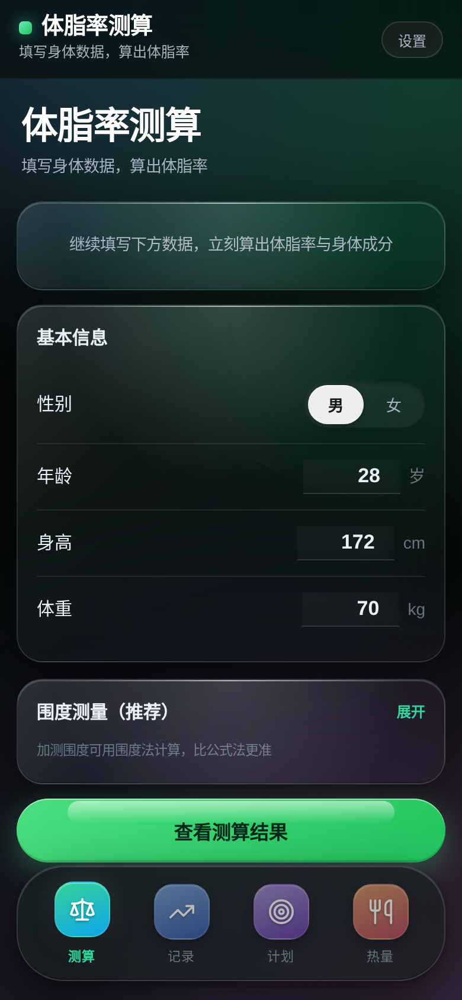
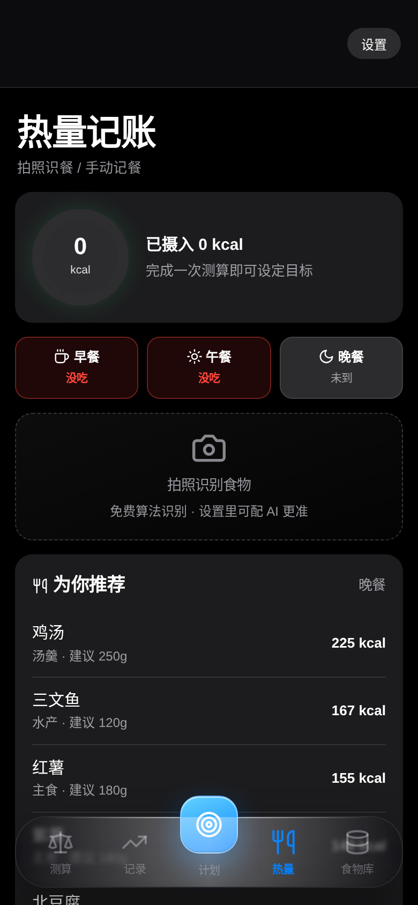
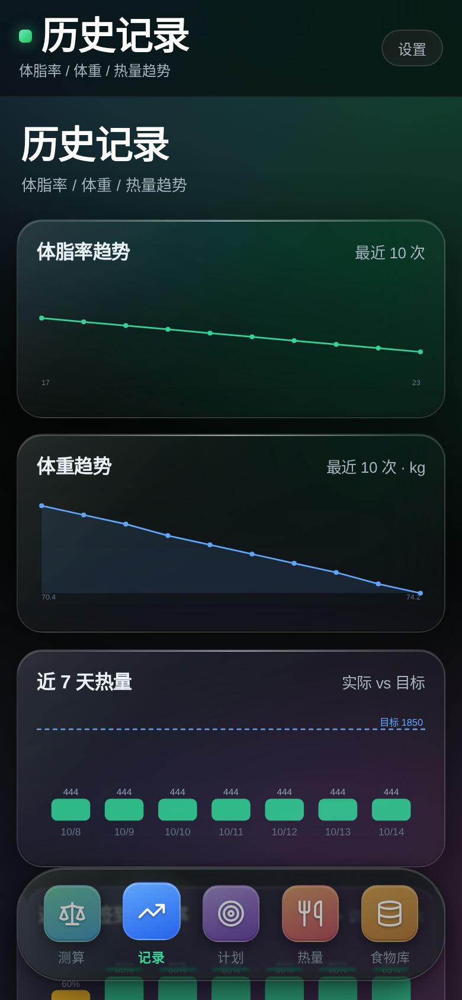
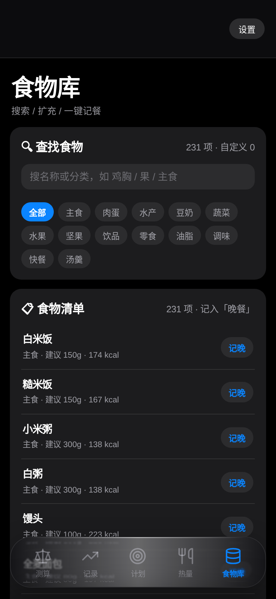

# 体脂率测算 · Body Fat Calculator

一个**单文件、离线优先**的体脂率测算与热量管理 App，采用 iOS 26 风格的**液态玻璃（Liquid Glass）**界面。
既可以直接在浏览器打开网页版使用，也可以安装安卓 APK。



## ✨ 功能

| 模块 | 说明 |
|---|---|
| **体脂测算** | 美国海军围度法（腰围/颈围，女性加臀围）与 Deurenberg 公式法；男女分档给出体脂等级、脂肪重量、去脂体重、标准体重区间 |
| **历史记录** | 保存每次测算，绘制体脂率与**体重趋势**折线图，支持删除单条 |
| **数据统计** | 近 7 天「实际热量 vs 目标」柱状图（超标变红）、近 7 天签到完成率、**今日三餐热量占比环形图** |
| **饮食锻炼计划** | 按体脂区间 + 目标（减脂/维持/增肌）生成每日热量、三大营养素配比、四餐餐单、七天训练安排 |
| **计划 → 签到** | 选定计划后该页直接变成每日签到：训练 + 三餐 + 饮水，做完即算一天，并记录连续签到天数 |
| **拍照识餐（离线 AI）** | 内置 Food-101 的 MobileNetV2 ONNX 模型，**完全离线**识别 101 类食物并映射到中文名与热量；自动记入当前餐，支持一键**纠正/撤销** |
| **食物库** | 232+ 种食物（主食/肉蛋/水产/蔬菜/水果/坚果/饮品/零食/快餐/汤羹/油脂/调味/豆奶），支持搜索、分类筛选、一键记餐、**自定义增删**（内置食物受保护不可删） |
| **热量记账** | 按三餐时间窗归类；过了饭点没记会显示「没吃」；环形进度显示摄入/目标，超标变红；未收录的食物**自动入库** |
| **数据备份** | 每次改动**自动在本机留快照**，可一键恢复；JSON 导出（安卓下直接写入「下载」目录）/ 导入；数据全部存于本机 localStorage，不上传 |

## 📁 目录结构

```
.
├── 体脂率测算.html          # 网页版（单文件，双击即可用；也是 APK 内的页面）
├── 体脂率测算-1.4.0.apk      # 已签名的安卓安装包（内含离线识别模型）
├── 体脂率测算-诊断版.apk     # 诊断包（仅一行文字的最小页面，用于排查“打不开”是外壳还是界面的问题）
├── gradle-app/              # 安卓工程（WebView 壳 + 本地 aapt2/d8 构建）
│   ├── settings.gradle
│   ├── build.gradle
│   ├── gradle.properties
│   └── app/
│       ├── build.gradle
│       ├── release.keystore
│       └── src/main/
│           ├── AndroidManifest.xml
│           ├── java/com/bodyfat/app/     # MainActivity（WebView + 原生桥 + 安全模式/崩溃自愈）
│           ├── res/                      # 图标 / 字符串
│           └── assets/
│               ├── index.html            # 打包进 APK 的页面
│               ├── ort.min.js            # onnxruntime-web 1.17.1（经典版，非多线程）
│               ├── ort-wasm-simd.wasm    # wasm 运行时
│               └── mobilenet_v2_food101.onnx  # Food-101 模型
└── docs/screenshots/        # 界面截图
```

## 🚀 使用方法

**网页版**：把 `体脂率测算.html` 用浏览器打开即可（手机浏览器同样可用）。
离线形态识别需要同目录放置 `ort.min.js` / `ort-wasm-simd.wasm` / `mobilenet_v2_food101.onnx`；缺失时会优雅降级为本地颜色识别算法。

**安卓版**：安装 `体脂率测算-1.4.0.apk`（Android 6.0 及以上），模型与运行时已随包内置，首次识别无需联网、无需任何密钥。

> **v1.4.0 关键修复（针对真机「装上但一闪就退」）**：
> 1. **安全模式**：首次启动（或检测到上次启动未完成就绪）时自动进入安全模式——WebView 软件渲染 + 关闭 iOS 26 位移玻璃特效（`feDisplacementMap` 是部分机型 GPU 驱动崩溃的高危项）。界面此时为「半透明玻璃」观感，功能完全不受影响。
> 2. **崩溃自愈**：若开启特效后 WebView 渲染进程崩溃（`onRenderProcessGone`），App 自行重建 WebView 并切回安全模式，不再整个进程被杀；用户手动开启特效视为授权，下次启动才会重新尝试。
> 3. **启动轨迹日志**：onCreate → loadUrl → 页面就绪每步落盘（应用目录 + 「下载」目录各一份），设置页可一键「导出诊断日志」。
> 4. **file:// 离线识别修复**：onnxruntime-web 以相对路径 `fetch('./ort-wasm-simd.wasm')` 加载 wasm，而原生 `fetch` 拒绝 `file:` 协议。现在页面内置 fetch 垫片：凡 `file://` 页面下的相对/绝对 file 请求一律改走 XHR（WebView 已开启 file 访问），实测模型加载约 0.5s、单次推理约 60ms，离线识别在纯 `file://` 外壳内即可工作，无需本地 HTTP 服务器。
> 5. **特效开关**：设置页新增「液态玻璃特效」卡片，可随时手动开/关；开启用硬件加速 + 真折射位移贴图，关闭为软件渲染。

## 🔨 自行构建 APK

前置：JDK 17+、Android SDK（`platforms/android-34` + `build-tools/34.0.0`）。

```bash
export ANDROID_HOME=/path/to/android-sdk
SDK=$ANDROID_HOME
BT=$SDK/build-tools/34.0.0
PLATFORM=$SDK/platforms/android-34/android.jar
ROOT=gradle-app/app/src/main
WORK=/tmp/apkbuild

mkdir -p $WORK/classes
# 1) 资源编译 + 链接（顺便把 assets 打进包）
$BT/aapt2 compile --dir $ROOT/res -o $WORK/res.zip
$BT/aapt2 link -o $WORK/base.apk -I $PLATFORM \
  --manifest $ROOT/AndroidManifest.xml -A $ROOT/assets $WORK/res.zip
# 2) 编译 Java → dex
javac --release 8 -classpath $PLATFORM -d $WORK/classes \
  $ROOT/java/com/bodyfat/app/MainActivity.java \
  $ROOT/java/com/bodyfat/app/FileProvider.java
$BT/d8 --release --lib $PLATFORM --output $WORK \
  $WORK/classes/com/bodyfat/app/MainActivity.class \
  $WORK/classes/com/bodyfat/app/FileProvider.class
# 3) 合并 dex + 对齐 + 签名
cp $WORK/base.apk $WORK/app-dex.apk
zip -q -j $WORK/app-dex.apk $WORK/classes.dex
$BT/zipalign -f -p 4 $WORK/app-dex.apk $WORK/app-aligned.apk
$BT/apksigner sign --ks $ROOT/release.keystore --ks-key-alias bft \
  --ks-pass pass:android --key-pass pass:android \
  --out 体脂率测算-1.4.0.apk $WORK/app-aligned.apk
```

### 离线食物识别所需资源

仓库内的 APK 已内置模型。若要从源码构建出同样的离线识别能力，需下载三个文件放到 `gradle-app/app/src/main/assets/`：

| 文件 | 大小 | 来源 |
|---|---|---|
| `ort.min.js` | 540 KB | [onnxruntime-web **1.17.1**](https://cdn.jsdelivr.net/npm/onnxruntime-web@1.17.1/dist/ort.min.js)（经典版，非 ESM/多线程，单线程即可跑） |
| `ort-wasm-simd.wasm` | 10.1 MB | 同上 CDN，同版本 `dist/` 目录 |
| `mobilenet_v2_food101.onnx` | 9.4 MB | ONNX Model Zoo 的 Food-101 MobileNetV2（101 类，Apache-2.0） |

缺失时 APK 依然可用，识别会降级为本地颜色算法。

## 📷 拍照识餐说明

识别链路为三级降级，**全部离线**：

1. **本地 ONNX 模型**（默认）：MobileNetV2 + Food-101，101 类；top-1 自动记入当前餐，置信度 <15% 时提示确认，可点其他候选纠正或一键撤销。实测加载约 0.4s、单次推理约 50ms。
2. **本地颜色算法**：无模型时的兜底，给出候选让你点选。
3. **可选 AI 识餐**：在「设置 → AI 识餐」填入视觉大模型密钥（OpenAI / 通义千问 / SiliconFlow 均可）可获得更精准的菜名与克数——这会联网。

> 注意：模型只认得 Food-101 收录的 101 类（偏西餐/日料）。对典型中餐会退化为「最接近的已知类 + 中文热量映射」，所以 UI 提供了候选切换与撤销来保证可用性。

## 🎨 界面

深色液态玻璃风格：悬浮玻璃 Dock（5 项：测算/记录/计划/热量/食物库）、彩色 iOS 圆角图标、跟随手指的阻尼高光与 3D 倾斜、彩色光斑壁纸、卡片周期扫光、SDF 位移图实现的真折射玻璃。APK 内首次启动默认「安全模式」（软件渲染、特效关闭）以保证任何机型都能打开，设置页可一键开启真折射特效。




> 记录页：体脂率/体重双趋势、近 7 天热量 vs 目标、签到完成率、今日热量来源


> 食物库：232+ 种食物，搜索/分类筛选/一键记餐/自定义增删

## 🔒 隐私

所有数据（测算记录、计划、签到、热量账本、自定义食物）保存在设备本地，**不会上传到任何服务器**。
默认识别流程完全在本机完成；仅当你主动配置 AI 密钥时，图片才会发送给对应的云服务。导出备份通过原生桥写入设备「下载」目录，不经网络。

## 📄 许可

MIT License
